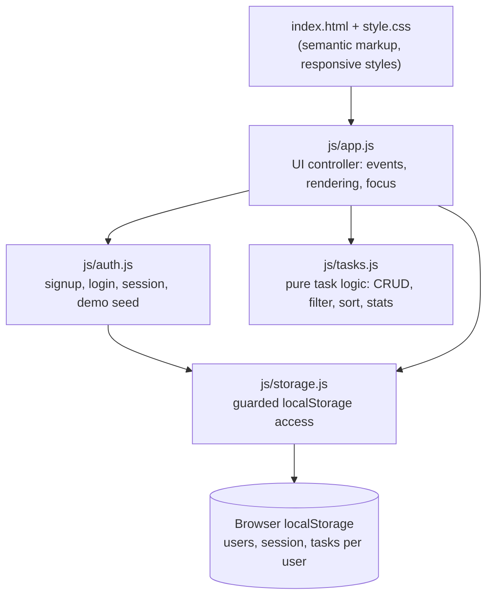

# TaskFlow: SaaS Task Manager

A production-style task manager built with plain HTML, CSS and ES6 modules (no build step). Users sign up or log in, then create, edit, filter, sort and delete tasks. Everything is saved between visits.

**Live demo:** https://dharani321-s.github.io/taskflow/ *(available after GitHub Pages is enabled, see Deployment)*
**Quick look:** click **Try the demo account** on the login screen.

## Feature highlights
| Area | What it does |
|---|---|
| Authentication (simulated) | Sign up, log in, log out; passwords are SHA-256 hashed before saving; session restored on reload |
| Interactive catalog | Status tabs, live search, sort by due date, priority or newest |
| CRUD | Create, edit (dialog form), change status inline, delete with confirmation |
| Dashboard | Live counts: total, in progress, done, overdue (overdue tasks flagged) |
| Persistent state | Per-user tasks and the session are stored in `localStorage` |
| Validation and errors | Inline field errors, `aria-invalid`, focus moved to the first error, storage-failure warning |
| Accessibility | Semantic landmarks, skip link, labelled controls, native `<dialog>` with focus return, live announcements, visible focus, 44px targets |
| Responsive and themed | Mobile-first CSS Grid/Flexbox, light and dark mode, reduced-motion support |

## Architecture


| Layer | Responsibility | Depends on |
|---|---|---|
| `app.js` | DOM events, rendering, dialogs, announcements | auth, tasks, storage |
| `auth.js` | Credential validation, hashing, session | storage, tasks (demo seed) |
| `tasks.js` | Pure functions; never mutate input | nothing |
| `storage.js` | The only file that touches `localStorage` | nothing |

Keeping business logic in pure modules makes it unit-testable without a browser.

## Project structure
```
taskflow/
├── index.html          # auth view, app view, task and confirm dialogs
├── style.css           # tokens, layout, components, dark mode
├── js/                 # app.js, auth.js, tasks.js, storage.js
├── tests/              # unit tests (node:test)
├── docs/screenshots/   # UI screenshots
└── .nojekyll           # tells GitHub Pages to serve files as-is
```

## Run locally
ES modules need a web server (opening `index.html` directly will not work):
```bash
npm start        # runs: npx serve .
```
Open the address it prints (for example http://localhost:3000). Requires Node 20+.

## Tests
```bash
npm test
```
11 unit tests cover validation, CRUD immutability, overdue logic, filtering, sorting, password hashing, duplicate emails and login. The UI flow (sign up, validation, add, edit, status change, delete, persistence after reload, logout, wrong password, filter, search, no horizontal scroll at 375px) was also verified end to end in headless Chromium.

## Deployment (GitHub Pages)
1. Push this repository to GitHub.
2. Repository **Settings → Pages**.
3. **Build and deployment → Source: Deploy from a branch**, branch `main`, folder `/ (root)`, **Save**.
4. After a minute the site is live at `https://<username>.github.io/taskflow/`.

Netlify or Vercel also work: import the repository, leave the build command empty and the publish directory as `/`.

## Known limitations
- Authentication is a **simulation** for demo purposes: accounts live in the visitor's own browser, so data is not shared across devices and this is not suitable for real user data.
- Replacing `storage.js` with calls to a real backend (for example a REST API with proper sessions) is the natural next step; the other modules would not need to change.

## Screenshots
See `docs/screenshots/`: login, signup validation, add-task dialog, dashboard, mobile view.
Live demo coming soon
